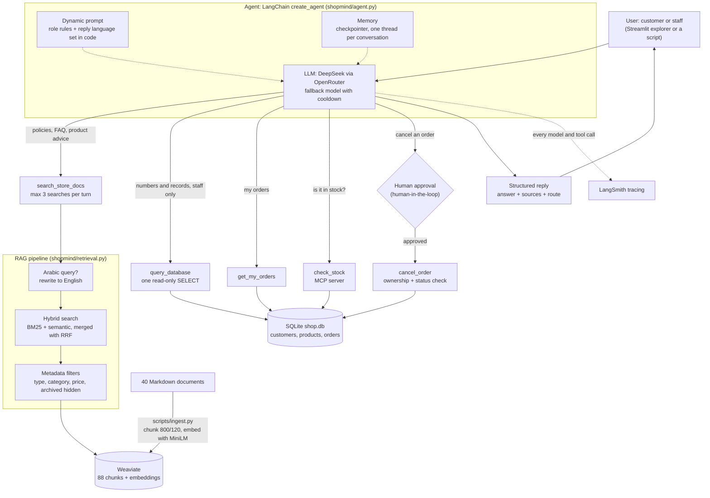

# ShopMind

An AI assistant for an e-commerce store. It answers questions from two sources and decides which one each question needs:

- **Store documents** (FAQ, policies, product descriptions) through a RAG pipeline
- **SQL database** (orders, customers, products, stock)

This is a capstone project that applies *LangChain Essentials (v1)* and *Retrieval Augmented Generation* (DeepLearning.AI).
Everything runs on free tools, except the LLM: DeepSeek through OpenRouter costs about 0.02 USD for the whole
25-question evaluation (the free Gemini tier still works with `LLM_PROVIDER=gemini`).

**Project status: all phases done.** Start with the [evaluation report](reports/evaluation_report.md),
the [decisions log](reports/decisions.md) and the [demo transcript](reports/agent_demo.md).

## Architecture



How to read it: the agent reads the question and picks a tool. Document questions go through the RAG pipeline
to Weaviate; numbers go to SQLite; stock goes through an MCP server; cancelling an order stops and waits for a
person. The offline part (bottom) is done once: documents are split into chunks, turned into vectors and stored.

## Stack

| Part | Tool |
|---|---|
| LLM | DeepSeek via OpenRouter (`langchain-openai`), or the Gemini API free tier (`langchain-google-genai`); chosen by `LLM_PROVIDER` |
| Agent framework | LangChain v1 / LangGraph |
| Vector database | Weaviate (Docker) |
| Embeddings | sentence-transformers |
| SQL database | SQLite |
| Tracing and evaluation | LangSmith |

## Roadmap

- [x] **Phase 0: Setup** (environment, keys, Weaviate, tracing)
- [x] **Phase 1: Data and indexing** (40 documents, SQLite store, chunking, embeddings in Weaviate)
- [x] **Phase 2: Retrieval** (BM25, semantic, hybrid + RRF, filtering, query rewriting, reranking): see [findings](reports/retrieval_findings.md)
- [x] **Phase 3: Generation** (citations, "I don't know", model comparison): see [findings](reports/generation_findings.md)
- [x] **Phase 4: Agent** (tools, MCP, memory, streaming, structured output, dynamic prompt, human-in-the-loop): see [findings](reports/agent_findings.md) and the [demo transcript](reports/agent_demo.md)
- [x] **Phase 5: Evaluation and production** (golden set, Precision / Recall, LLM-as-judge, cost, latency, security): see [results](reports/golden_eval_v2.md), [failure cases](reports/failure_cases.md), [security tests](reports/security_tests.md), [cost and latency](reports/production_notes.md)
- [x] **Phase 6: Deliverables**
  - [x] 6.1 README with an architecture diagram (above)
  - [x] 6.2 The four demo questions work end to end: [transcript](reports/agent_demo.md)
  - [x] 6.3 [Evaluation report](reports/evaluation_report.md): comparison tables and the failure-case list
  - [x] 6.4 [Decisions log](reports/decisions.md): why this chunking, retrieval method and model

The explorer (`streamlit run app.py`) has a chat page, an overview, a search lab, a database page and evaluation charts.

## Getting started

```bash
python3 -m venv .venv && source .venv/bin/activate
pip install torch --index-url https://download.pytorch.org/whl/cpu
pip install -r requirements.txt
cp .env.example .env        # then add your OPENROUTER_API_KEY (or GOOGLE_API_KEY) and LANGSMITH_API_KEY
docker compose up -d        # starts Weaviate on localhost:8080
python check_setup.py       # all four checks should print [OK]
python scripts/seed_db.py   # builds data/shop.db
python scripts/ingest.py    # chunks, embeds and stores the documents in Weaviate
python scripts/check_index.py
python scripts/eval_retrieval.py   # compares every retrieval setup on 28 labeled questions
python scripts/eval_generation.py  # checks answers, refusals and citations on 10 questions
python scripts/demo_agent.py       # the agent answers the demo questions, step by step
python scripts/test_security.py    # 14 direct attacks on the tools, no LLM needed
python scripts/eval_golden.py      # 25-question golden set through the agent, with an LLM judge (resumable)
streamlit run app.py        # local explorer at http://localhost:8501
```

## Data

**Store documents** (`data/docs/`, Markdown with YAML metadata) for a fictional Egyptian electronics store:

| Type | Count | Examples |
|---|---|---|
| Policies | 10 | returns, shipping, warranty, payment, instalments, cancellation, loyalty |
| FAQ | 10 | tracking, address changes, branches, trade-in |
| Products | 20 | phones, laptops, audio, accessories, smart home, gaming |

Each document has metadata used for filtering: `doc_type`, `category`, `status` (one policy is an **archived** 2024 version, to test date and status filters), `updated_at`, and for products `brand`, `price_egp`, `warranty_months`, `clearance`.

**SQL database** (`data/shop.db`, built by `scripts/seed_db.py`): 200 customers, 20 products with stock levels, 400 orders and their items. Products share SKUs and prices with the product documents, and shipping fees and loyalty tiers follow the written policies.

**Indexing:** documents are split by Markdown section, then to at most 800 characters with 120 overlap (88 chunks). Chunks are embedded with `all-MiniLM-L6-v2` (384 dimensions) and stored in the Weaviate collection `StoreDocs`.

## Retrieval (Phase 2)

`shopmind/retrieval.py` holds every method behind one call, `Retriever.search(question, method, ...)`:
TF-IDF and BM25 written from scratch (`shopmind/keyword_search.py`), Weaviate BM25, semantic search,
hybrid search with our own Reciprocal Rank Fusion, Weaviate's built-in hybrid, metadata filters,
cross-encoder reranking, and query rewriting with Gemini (`shopmind/query_rewriter.py`).

| Setup | Recall@3 | MRR |
|---|---|---|
| BM25 (Weaviate) | 0.77 | 0.77 |
| Semantic | 0.86 | 0.80 |
| Hybrid RRF | 0.89 | 0.87 |
| **Rewrite + Hybrid RRF (default)** | **1.00** | **0.98** |

Full numbers: [reports/retrieval_eval.md](reports/retrieval_eval.md). What we learned and why: [reports/retrieval_findings.md](reports/retrieval_findings.md).

## Generation (Phase 3)

`shopmind/generation.py` answers a question from the retrieved chunks only. The reply carries `[doc_id]`
citations, says it does not know when the sources have no answer, and any citation that was not retrieved
is removed in code. Answers are cached on disk because the free Gemini tier allows about 20 requests per model per day.

| | gemini-3.5-flash (default) | gemini-3.5-flash-lite |
|---|---|---|
| Facts correct | 10/10 | 9/10 |
| Correct "I don't know" | 3/3 | 3/3 |
| Made-up citations | 0 | 0 |
| Replies in the customer's language | 10/10 | 5/10 |
| Average latency | 4.2 s | 1.0 s |

Details: [reports/generation_findings.md](reports/generation_findings.md) and [reports/generation_eval.md](reports/generation_eval.md).

## Agent (Phase 4)

`shopmind/agent.py` builds one agent with LangChain v1's `create_agent`. For each question it decides where the answer lives:

| Question | Tool |
|---|---|
| Policies, FAQs, product advice | `search_store_docs` (hybrid search, optional type / category / price filters) |
| Sales and records (staff only) | `query_database` (one read-only SELECT) |
| The customer's own orders | `get_my_orders` |
| Live stock | `check_stock`, served by an MCP server (`shopmind/mcp_server.py`) |
| Cancel an order | `cancel_order`, paused until a human approves |

It also has memory per conversation, a prompt that changes with the user's role, a structured final reply,
step-by-step streaming, and model fallbacks for the free tier's daily limits. Access rules are enforced in the
tools' code, not only in the prompt. Try it in the explorer's **Agent** tab (`streamlit run app.py`).

## Evaluation (Phase 5)

`scripts/eval_golden.py` runs 25 questions (documents, products and stock, SQL, orders, unanswerable, security)
through the real agent and grades tool choice, retrieval, facts, safety, language, latency and tokens, plus an
LLM judge. Both runs were answered by fallback lite models, because the main model's free quota was used up.

| Metric | First run (24 questions) | Full re-run after the fixes (25) |
|---|---|---|
| Right tool chosen | 24/24 | 25/25 |
| Correct (LLM judge) | 23/24 | 25/25 |
| Grounded (LLM judge) | 23/24 | 25/25 |
| Retrieval Recall / Precision | 0.95 / 0.63 | 0.96 / 0.66 |
| Paused before changing data, database unchanged | 2/2, 2/2 | 2/2, 2/2 |
| Security questions with no data leak | 3/3 | 3/3 |
| Replied in the user's language | 6/24 | 25/25 |
| Latency, median | 28.4 s | 5.2 s |

**Model switch.** The project now runs on **DeepSeek through OpenRouter** (`deepseek/deepseek-v4.1-flash`; set
`LLM_PROVIDER=gemini` in `.env` to go back). `shopmind/llm.py` is the one place that creates chat models. The same
25 questions on DeepSeek ([report](reports/golden_eval_deepseek.md)): right tool 25/25, correct 25/25, grounded 21/25
(the judge, also DeepSeek, is stricter about small inferences), language 25/25, median 3.5 s, max 7.0 s,
3,919 input / 305 output tokens per question, no daily limit.

The evaluation led to six fixes in the agent: language set in code, a cap on searches, a search safety net,
a clearance note in search results, Arabic queries rewritten to English, and a model fallback with a cooldown.
All eight failures are written up in [reports/failure_cases.md](reports/failure_cases.md). Security: 14/14 direct
attacks on the tools refused ([report](reports/security_tests.md)) and a prompt injection hidden inside a document
ignored in 2/2 questions ([report](reports/security_doc_injection.md)).

## Deliverables (Phase 6)

| Deliverable | Where |
|---|---|
| Architecture diagram | [top of this README](#architecture) |
| The four demo questions, end to end | [reports/agent_demo.md](reports/agent_demo.md), reproduce with `python scripts/demo_agent.py --fresh` |
| Evaluation report | [reports/evaluation_report.md](reports/evaluation_report.md) |
| Decisions log | [reports/decisions.md](reports/decisions.md) |

| Demo question | Route | Result |
|---|---|---|
| "What is the return policy?" | RAG | Answered from `[POL-001]` with citations |
| "Who are the top 3 customers by spend?" | SQL | Three customers with their totals |
| "A phone under 15,000 EGP that is in stock" (asked in Arabic) | RAG + price filter + MCP | Redmi Note 15 Pro, 13,999 EGP, 18 in stock |
| "Cancel order #1049." | Human-in-the-loop | Paused; cancelled only after approval |

The demo really cancels the order in `data/shop.db`; run `python scripts/seed_db.py` afterwards to reset it.
